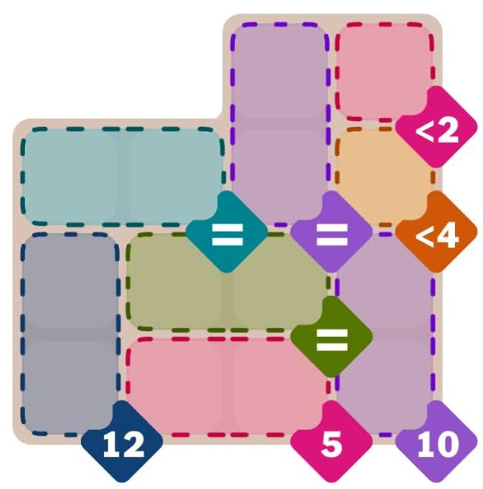

<p align="center"></p>

# Pips Build

Pips Build turns a screenshot of a Pips-style domino logic puzzle into a board you can play in the browser.

1. Upload, paste, or drag in a screenshot (phone or desktop capture).
2. The app reads the board, regions, conditions and domino tray on your device. Nothing is uploaded anywhere.
3. Check the result, optionally over the original screenshot with an opacity slider, and fix anything that's wrong. A strip at the top always says whether the puzzle can be solved and how many solutions it has (see below).
4. Play: drag dominoes from the tray onto the board until every condition is met. A timer runs while you solve.

There's no screenshot? Use **Build manually** to draw the board, regions, conditions and dominoes yourself. Any puzzle can be saved to a JSON file from the check/edit screen and loaded again with **Import puzzle file**.

The app has no server, account, database or network calls. Progress is saved in the browser's local storage.

## Run

```
npm install
npm run dev      # development server
npm run build    # static build in dist/ (open with any static file host)
npm test         # unit tests (game engine + screenshot recognition)
```

## Scripts

| Command | What it does |
| --- | --- |
| `npm run dev` | Starts the development server. |
| `npm run build` | Typechecks and builds the static site into `dist/`. |
| `npm test` | Runs all tests: game rules, the solution counter, and every screenshot in `samples/` checked against its golden file. It can run while the dev server is up. |
| `npm run test:engine` / `npm run test:vision` | Runs only the game-rule tests, or only the screenshot-recognition tests. |
| `npm run save:goldens` | Saves what the app recognises in every `samples/gameN.jpg` as `samples/goldens/gameN.json`. These golden files are what `npm test` compares against. |
| `npm run save:goldens -- game10 game3` | Same, but only for the named samples. Unchanged goldens are left untouched, so `git diff samples/goldens` shows only real changes. Review new or changed goldens before committing them. |
| `npm run check:chrome` | Runs every sample through the real app in your installed Chrome (set `CHROME_PATH` to use another browser) and compares it with its golden. It also checks the `?debug=1` buttons. |
| `npm run count:solutions` / `npm run count:solutions -- game10 --show` | Counts the solutions of every sample's golden puzzle (or the named ones). With `--show` it draws each solution: the pips on every square, and which squares share a domino. |
| `npm run analyze` / `npm run analyze -- game4` | Prints what the recogniser reads from every sample (or just the named ones), as text. |
| `npm run train:glyphs` | Re-learns the condition characters (digits and `< > = ≠`) from the samples and their goldens. |

## Is the puzzle solvable?

On the **Check the puzzle** and **Build the puzzle** screens a strip under the top bar always shows the answer, and it stays in view while you scroll:

- **Green**, `Solvable: 3 solutions`: the dominoes can be placed so every condition holds, and how many different ways there are.
- **Red**, `Not solvable`: no arrangement works. It says why when that is obvious, for example `The board has 22 cells, but 10 dominoes cover 20.` or a condition that the dominoes can never reach.

Solutions are counted without duplicates. Two arrangements count as one when every condition holds the same pips and every square outside the conditions has the same pip. So identical dominoes swapped, a double such as 3|3 turned around, and 2|3 against 3|2 inside a "sum 5" condition are each one solution, and so are two arrangements that pair the squares into dominoes differently but put the same pips in every condition. Turning a domino whose two squares belong to different conditions does change what the conditions see, so that counts separately.

Counting runs in the background and stops at 1,000 solutions (`1,000 or more solutions`) or after 2.5 seconds (`at least N solutions`, or an amber note if no solution was found in time).

## Debug flag

Open the dev server with `?debug=1`, e.g. `http://localhost:5173/?debug=1`. The home screen then shows a **Debug: load a sample** card with one button per screenshot in `samples/` (game1, game2, ...). Clicking a button loads that screenshot exactly as if you had uploaded it, so you can try the samples without browsing for files.

## Adding a sample

1. Put `gameN.jpg` in `samples/` (the name must be `game` followed by a number).
2. Run `npm run save:goldens -- gameN`, then check the result: load it with its `?debug=1` button, or open `samples/goldens/gameN.json` with **Import puzzle file**.
3. Run `npm test` and `npm run check:chrome`.
